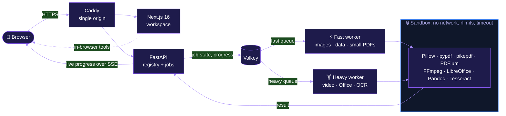

<div align="center">


### The self-hosted file workshop: 82 tools in one private workspace

<a href="#-quick-start">
  
</a>

<br/>

<a href="https://github.com/kritxnshu/FileForge/stargazers"></a>
<a href="https://github.com/kritxnshu/FileForge/network/members"></a>
<a href="https://github.com/kritxnshu/FileForge/issues"></a>
<a href="https://github.com/kritxnshu/FileForge/commits"></a>

<br/>


<br/><br/>

**[Features](#-what-you-can-do)** ·
**[How it works](#-how-it-works)** ·
**[Security](#-security-by-design)** ·
**[Quick start](#-quick-start)** ·
**[Configuration](#-configuration)** ·
**[Testing](#-testing)** ·
**[Contributing](#-contributing)**

</div>


## ✨ Why FileForge

Most online converters make you upload private documents to someone else's computer. Then you bounce between
five different sites and hope the file you download actually opens.

**FileForge runs the whole pipeline on a server you control.** Every job runs in a sandbox with no network
access. The interface only offers a conversion after a test has proven it works, and every upload is deleted
automatically.

<table>
  <tr>
    <td align="center" width="25%">
      <h3>🔐 Private</h3>
      <sub>Self-hosted. Files auto-delete after 60&nbsp;minutes. Logs never contain file names or contents.</sub>
    </td>
    <td align="center" width="25%">
      <h3>🧪 Proven</h3>
      <sub>Each operation is shown only after its positive and negative tests pass.</sub>
    </td>
    <td align="center" width="25%">
      <h3>⚡ Fast</h3>
      <sub>Separate fast and heavy queues. A long video encode never blocks a quick image resize.</sub>
    </td>
    <td align="center" width="25%">
      <h3>🧰 Complete</h3>
      <sub>Convert, edit, sign, redact, compress and batch-download from one workspace.</sub>
    </td>
  </tr>
</table>

## 📊 At a glance

<div align="center">


| Support level | Format pairs | What it means |
|:---|---:|:---|
| 🟢 **Full** | **633** | Tested end to end, and the output is checked by an independent parser |
| 🔵 **Partial** | **23** | Works, with documented limits (for example, layout fidelity) |
| 🟡 **Experimental** | **16** | Available, but rough edges are expected |
| ⚪ **Unsupported** | **4** | Never offered in the UI |

</div>

Every pair is listed in the generated [support matrix](docs/SUPPORT_MATRIX.md).

## 🧰 What you can do

<details open>
<summary><b>📕 PDF toolkit</b> · 36 tools</summary>
<br/>

| Organize | Edit & annotate | Secure | Convert |
|:---|:---|:---|:---|
| Merge PDFs | Edit PDF | Password-protect | PDF → Word |
| Split PDF | Sign PDF | Remove password | PDF → text |
| Organize pages | Fill PDF form | Redact | PDF → images |
| Extract pages | Create a form | Flatten | Images → PDF |
| Delete pages | Add page numbers | Convert to PDF/A | HTML → PDF |
| Reorder pages | Text watermark | Repair PDF | Make searchable (OCR) |
| Rotate pages | Image watermark | Edit properties | Export form data |
| Crop PDF | Compare PDFs | Compress PDF | Extract images |
| Resize pages | Pages per sheet | | Office docs ↔ PDF |

</details>

<details>
<summary><b>🖼️ Images</b> · 7 tools · PNG · JPG · WebP · AVIF · HEIC · GIF · BMP · TIFF · ICO · SVG</summary>
<br/>

- **Convert** between raster formats, keeping transparency and animation wherever the target supports them
- **Resize** by percentage, width, height or bounding box
- **Compress** by re-encoding, with optional downscaling and metadata stripping
- **Strip metadata** or set DPI
- **Convert to HEIC**, **render SVG** to raster, and **trace** raster images into vector SVG

</details>

<details>
<summary><b>📄 Documents</b> · DOCX · DOC · ODT · RTF · Markdown · HTML · TXT</summary>
<br/>

- Office document conversion powered by LibreOffice
- Markdown ↔ HTML ↔ DOCX through Pandoc, always run with `--sandbox`
- HTML → PDF rendered by headless Chromium

</details>

<details>
<summary><b>📊 Spreadsheets</b> · 5 tools · XLSX · XLS · ODS · CSV · TSV · JSON</summary>
<br/>

- Convert spreadsheets between formats, or export them to PDF
- Pull **tables out of PDFs** into a spreadsheet
- Export sheet data, or build a new spreadsheet from structured data

</details>

<details>
<summary><b>📽️ Presentations</b> · 4 tools · PPTX · PPT · ODP</summary>
<br/>

- Convert presentations, or export slides as images
- Turn a set of images, or a PDF, into a PowerPoint deck

</details>

<details>
<summary><b>🎬 Audio & video</b> · 8 tools · MP4 · MOV · MKV · WebM · AVI · MP3 · FLAC · WAV · Opus …</summary>
<br/>

| Video | Audio |
|:---|:---|
| Convert video (MP4, MOV, MKV, WebM, AVI, FLV, WMV, 3GP) | Convert audio (MP3, AAC, M4A, FLAC, WAV, OGG, Opus, WMA) |
| Trim and compress | Trim and adjust |
| Video → GIF and GIF → video | Extract audio from video |
| Grab a frame as an image | |

All powered by FFmpeg on the dedicated heavy queue.

</details>

<details>
<summary><b>🗜️ Archives</b> · 5 tools · ZIP · 7Z · RAR · TAR · GZ · BZ2 · XZ</summary>
<br/>

- Convert between archive formats, extract files, create ZIPs, and gzip or gunzip single files
- Guarded against zip bombs: limits on entry count, unpacked size, compression ratio and nesting depth

</details>

<details>
<summary><b>🛠️ Developer tools</b> · 10 tools · JSON · YAML · TOML · XML · CSV · SQL · HTML · CSS · JS</summary>
<br/>

- Convert data between JSON, YAML, TOML, XML and CSV, by pasting text or uploading a file
- JSON formatter and validator with exact line and column errors
- Code beautifier and minifier, plus HTML ↔ Markdown
- CSV → SQL `INSERT` statements
- Base64 and URL encode/decode, and a Unix timestamp converter

> Paste-based tools run **entirely in your browser**. Nothing is uploaded.

</details>

<details>
<summary><b>🧪 Utilities</b> · 7 tools · fonts · colors · QR codes</summary>
<br/>

- Convert fonts between TTF, OTF, WOFF and WOFF2, and convert font outlines
- QR code generator, color converter (HEX, RGB, HSL), image → Base64
- Length and file-size unit converters

> Everything here except the font tools runs **in your browser**.

</details>

## 🧭 How it works



1. **Upload.** Files stream to the API, which enforces size limits as the bytes arrive.
2. **Route.** The registry checks that the operation is verified for that input, then queues the job on the fast or heavy queue.
3. **Convert.** Each job runs as its own sandboxed process with no network access, capped CPU, memory and output size, and a timeout that kills the whole process group.
4. **Deliver.** Progress streams back over Server-Sent Events. Results are ready to download alone or as a batch ZIP.
5. **Forget.** A sweeper deletes uploads and results when the retention window ends.

## 🔒 Security by design

| Layer | Protection |
|:---|:---|
| 🌐 **Network** | Workers sit on an `internal` Docker network with no gateway. Native runs use Seatbelt (macOS) or bubblewrap `--unshare-net` (Linux). |
| 📁 **Filesystem** | Read-only root filesystem. Only the job directory and `/tmp` are writable. |
| ⏱️ **Resources** | Wall-clock timeouts per queue, plus `RLIMIT_CPU`, `RLIMIT_AS` and `RLIMIT_FSIZE` on every job. |
| 💣 **Bombs** | Pillow decompression-bomb limit (100 MP). Archive entry, size, ratio and depth caps. |
| 🧱 **Containers** | `cap_drop: [ALL]`, read-only containers, private networking. |
| 🗑️ **Retention** | Files are deleted after `FILE_RETENTION_MINUTES` (default 60). Valkey keeps nothing on disk. |
| 🕵️ **Privacy** | Logs record job IDs, formats, sizes and durations, never file names or contents. |

Each mitigation is backed by a test. See the full [threat model](docs/SECURITY.md).

## 🚀 Quick start

### 🐳 Docker Compose (recommended)

```bash
git clone https://github.com/kritxnshu/FileForge.git
cd FileForge
docker compose up -d --build
```

Then open **http://localhost:8080** 🎉

<details>
<summary><b>🌍 Production domain with automatic HTTPS</b></summary>
<br/>

```bash
UC_SITE_ADDRESS=convert.example.com docker compose up -d --build
```

Point the domain at your server and open ports `80` and `443`. Caddy gets the TLS certificate automatically.
See the [deployment guide](docs/DEPLOYMENT.md) for scaling, isolation and upgrades.

</details>

### 💻 Native development

<details>
<summary><b>🍎 macOS prerequisites</b></summary>
<br/>

```bash
brew install uv node pnpm redis caddy ffmpeg pandoc tesseract
brew install --cask libreoffice
```

</details>

<details>
<summary><b>🐧 Ubuntu prerequisites</b></summary>
<br/>

```bash
sudo apt install ffmpeg pandoc libreoffice-nogui redis-server \
  libarchive-tools bubblewrap tesseract-ocr
# Also install uv, Node.js, pnpm and Caddy
```

</details>

```bash
make setup   # Python deps (uv), Chromium for Playwright, web + e2e packages
make dev     # full stack at http://localhost:8080
```

| Where | URL |
|:---|:---|
| 🏠 App | http://localhost:8080 |
| 📕 PDF toolkit | http://localhost:8080/pdf |
| 🛠️ All tools | http://localhost:8080/tools |
| 📘 OpenAPI docs | http://localhost:8080/api/docs |
| 💓 Health and isolation mode | http://localhost:8080/api/health |

## 🔧 Configuration

All settings are environment variables. These are the ones you are most likely to change:

| Variable | Default | Purpose |
|:---|:---|:---|
| `PUBLIC_BASE_URL` | `http://localhost:8080` | Public origin of the site |
| `MAX_FILE_SIZE_MB` | `100` | Per-file upload limit (non-video) |
| `MAX_VIDEO_SIZE_MB` | `500` | Per-file limit for video |
| `MAX_BATCH_FILES` | `20` | Files per upload or batch |
| `FILE_RETENTION_MINUTES` | `60` | When uploads and results are deleted |
| `JOB_TIMEOUT_FAST_S` / `JOB_TIMEOUT_HEAVY_S` | `60` / `900` | Wall-clock limit per queue |
| `WORKER_CONCURRENCY_FAST` / `_HEAVY` | CPU-based | Jobs each worker runs at once |
| `TRUSTED_PROXY_HOPS` | `0` | Reverse proxies in front of the API (used for rate limiting) |

The complete reference is in [docs/ENV.md](docs/ENV.md).

## 🧪 Testing

```bash
make test    # everything: API, web, matrix check, end-to-end
```

| Command | What it runs |
|:---|:---|
| `make test-api` | Converter matrix, negative, security, lifecycle and HTTP tests (pytest) |
| `make test-web` | Type-check, ESLint and Vitest unit tests for in-browser tools |
| `make test-e2e` | Playwright user journeys against the running stack |
| `make matrix` | Regenerates [`docs/SUPPORT_MATRIX.md`](docs/SUPPORT_MATRIX.md) |
| `make check-matrix` | Fails if any advertised pair lacks a passing test |

> [!IMPORTANT]
> The UI only advertises a conversion when its matrix test **and** its operation's negative test have passed,
> its engines are installed, and its feature flag is on. Generated files are build artifacts, so change the tests
> and fixtures rather than editing them by hand.

## 🧱 Adding a converter

```text
 register Operation ──► fixture ──► positive + negative tests ──► make matrix ──► it shows up in the UI ✨
```

1. Register an `Operation` in `services/api/engine/converters/<category>/`.
2. Declare its formats, engine, queue (`fast` or `heavy`), options and support level.
3. Add a fixture builder to `tests/fixtures/generate.py`.
4. Add positive matrix coverage and a negative test.
5. Run `make test && make matrix`.

The registry then generates the JSON Schema for the settings form, the conversion routes and the capability data
the UI reads. No frontend changes are needed.

## 🗂️ Project structure

```text
FileForge/
├── apps/web/                  # Next.js 16 + React 19 workspace
│   └── src/
│       ├── app/               # routes: convert, tools, pdf, formats, docs
│       ├── components/        # drop zone, command palette, PDF editor, history
│       └── lib/tools/         # in-browser tools (JSON, code, Base64, colors…)
├── services/api/
│   ├── app/                   # FastAPI: uploads, jobs, storage, sweeper
│   ├── engine/                # registry, sandbox, converters by category
│   └── worker.py              # arq workers (fast / heavy)
├── tests/                     # api (pytest) · e2e (Playwright) · fixtures
├── deploy/Caddyfile           # single-origin reverse proxy + auto TLS
├── docs/                      # architecture, security, env, matrix…
└── docker-compose.yml         # valkey · api · workers · web · caddy
```

## 📚 Documentation

| Guide | What's inside |
|:---|:---|
| 🏗️ [Architecture](docs/ARCHITECTURE.md) | Components, request flow, registries and storage |
| 📋 [Support matrix](docs/SUPPORT_MATRIX.md) | Every operation and format pair, with its support level |
| 🛡️ [Security](docs/SECURITY.md) | Threat model, mitigations and the tests that prove them |
| ⚙️ [Environment](docs/ENV.md) | Every runtime setting and limit |
| 🚢 [Deployment](docs/DEPLOYMENT.md) | TLS, isolation, scaling and upgrades |
| 🧠 [Decisions](docs/DECISIONS.md) | Architecture decisions and tradeoffs |
| 📜 [Third-party licenses](docs/THIRD_PARTY_LICENSES.md) | Engine and dependency licenses |
| 📈 [Progress](PROGRESS.md) | Milestones and known work |

> [!WARNING]
> **Before a public deployment,** review the privacy notice and terms, set a retention window you are comfortable
> with, and confirm the isolation mode reported by `/api/health` meets your requirements.

## 🤝 Contributing

Issues, bug reports and focused pull requests are welcome.

```bash
git switch -c feature/my-improvement
make test
```

- **Bugs:** include steps to reproduce and, if you can, a sample file.
- **New conversions:** include the fixture plus positive and negative tests (see [Adding a converter](#-adding-a-converter)).

<div align="center">

<br/>

<a href="https://github.com/kritxnshu/FileForge/issues/new"></a>
<a href="https://github.com/kritxnshu/FileForge/compare"></a>
<a href="https://github.com/kritxnshu/FileForge/stargazers"></a>

<br/><br/>

Built with ❤️ by **[Kritanshu](https://github.com/kritxnshu)**

<sub>If FileForge saved you a trip to a sketchy converter site, consider leaving a ⭐</sub>


</div>
