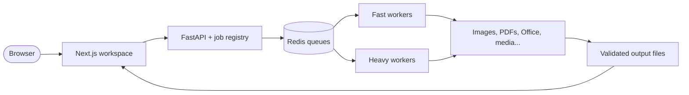

<div align="center">


# FileForge

**One workspace. Every file. Real conversions.**

[](apps/web)
[](services/api)
[](docker-compose.yml)

Convert, edit, secure, and optimize files without moving between tools.

**Images · Documents · PDFs · Spreadsheets · Presentations · Audio · Video · Archives · Fonts · Developer Tools**

</div>

---

## Why FileForge?

FileForge is a production-focused, self-hostable file toolbox built around a simple promise:
**if the interface offers a conversion, it really works.**

Every advertised conversion is validated by opening the generated result with an independent parser. Unsupported
pairs are never guessed, and the support matrix is generated from the same registry and test evidence that powers
the UI.

<div align="center">

| Real file processing | File-first workflow | Privacy by design | Verified results |
|:---:|:---:|:---:|:---:|
| Powered by proven native engines | Batch uploads, previews, settings and ZIP downloads | Sandboxed, network-disabled conversion processes | Generated support matrix backed by tests |

</div>

## Built for serious workflows

### Universal conversion hub

Drop in one or many files, receive automatic format detection, choose from only the operations supported for that
file, adjust conversion settings, track real progress, preview when useful, and download everything individually or
as a ZIP.

### Complete PDF toolkit

Explore more than 40 PDF tools at `/pdf`, including:

<table>
  <tr>
    <td><strong>Pages</strong><br>Merge, split, organize, reorder, crop and rotate</td>
    <td><strong>Editing</strong><br>Edit text, shapes, images, drawings and add page numbers</td>
  </tr>
  <tr>
    <td><strong>Documents</strong><br>Convert to and from Office formats and images</td>
    <td><strong>Security</strong><br>Protect, unlock, redact and sanitize sensitive content</td>
  </tr>
  <tr>
    <td><strong>Forms</strong><br>Fill, create, inspect and manage PDF forms</td>
    <td><strong>Review</strong><br>Sign, watermark, compare, scan and compress</td>
  </tr>
</table>

### Developer tools

Work with JSON, YAML, CSV, SQL, XML, Markdown, QR codes, encoding, checksums and common text transformations
entirely from the browser.

## How it works



| Layer | Technology |
|---|---|
| **Frontend** | Next.js 16 App Router, React 19, TypeScript, Tailwind CSS, Motion and Lucide |
| **API** | Python 3.12, FastAPI, Pydantic, arq workers |
| **Storage & jobs** | Redis queues, isolated job directories, configurable retention |
| **Document engines** | pypdf, pikepdf, PDFium, OpenPyXL, python-docx, python-pptx, ReportLab, LibreOffice and Pandoc |
| **Media engines** | Pillow, pillow-heif, resvg, FFmpeg and fontTools |
| **Delivery** | Caddy routes the web app and API on one origin |
| **Security model** | Sandboxed conversion processes with network access disabled |

## Support at a glance

The live support matrix currently records:

| Support level | Format pairs |
|---|---:|
| Full | 633 |
| Partial | 23 |
| Experimental | 16 |
| Unsupported | 4 |

See [the generated support matrix](docs/SUPPORT_MATRIX.md) for the complete operation-by-operation breakdown.

## Quick start

### Docker Compose

```sh
docker compose up -d --build      # → http://localhost:8080
```

For a public deployment, set `UC_SITE_ADDRESS=convert.example.com` in Caddy's environment. See the
[deployment guide](docs/DEPLOYMENT.md).

### Native development

Install the system tools once:

```sh
# macOS (Homebrew)
brew install uv node pnpm redis caddy ffmpeg pandoc tesseract   # uv fetches Python 3.12 itself
brew install --cask libreoffice

# Debian/Ubuntu
sudo apt install ffmpeg pandoc libreoffice-nogui redis-server libarchive-tools bubblewrap tesseract-ocr
#   plus uv (https://docs.astral.sh/uv/), Node 22 + pnpm (corepack enable), and Caddy (https://caddyserver.com/docs/install)
```

Then, from the repo root:

```sh
make setup     # Python venv (uv), Playwright's Chromium, web + e2e dependencies
make dev       # Redis, API, both workers, Next.js and Caddy → http://localhost:8080
```

When the stack is running:

- **App:** http://localhost:8080
- **PDF toolkit:** http://localhost:8080/pdf
- **OpenAPI docs:** http://localhost:8080/api/docs
- **Engine health:** http://localhost:8080/api/health

## Tests

```sh
make test
```

That runs everything, in order:

| Target | What it runs |
|---|---|
| `make test-api` | Converter matrix, independent-output validation, negative cases, security tests, lifecycle tests, concurrency and live HTTP/worker checks |
| `make test-web` | TypeScript, ESLint and client-side tool round-trip tests |
| `make matrix` / `make check-matrix` | Generate and verify the support matrix against test evidence |
| `make test-e2e` | Real browser journeys, responsive layouts, dark mode, CSP and WCAG checks |

**What gets advertised is decided by the tests.** A pair appears in the UI only after its test passes, and stops
appearing if it fails (DECISIONS D7). Don't edit `verified.json` or `SUPPORT_MATRIX.md` by hand.

## Extend the platform

Add a converter module under `services/api/engine/converters/<category>/` that registers an `Operation` (formats,
cardinality, a Pydantic options model, engines, queue, target support level, limitations), a fixture builder in
`tests/fixtures/generate.py`, and a matrix test plus a negative test. The UI picks up the new operation, its settings
form (from the JSON Schema) and its `/convert/<a>-to-<b>` page automatically.

## Documentation

| Guide | Purpose |
|---|---|
| [Architecture](docs/ARCHITECTURE.md) | Components, request flow, registry and storage |
| [Support matrix](docs/SUPPORT_MATRIX.md) | Generated operation and format coverage |
| [Security](docs/SECURITY.md) | Threat model, mitigations and security test coverage |
| [Environment](docs/ENV.md) | Configuration variables |
| [Deployment](docs/DEPLOYMENT.md) | TLS, worker isolation, scaling and upgrades |
| [Decisions](docs/DECISIONS.md) | Architecture decisions and recorded deviations |
| [Third-party licenses](docs/THIRD_PARTY_LICENSES.md) | Dependency and engine licensing |
| [Progress](PROGRESS.md) | Milestones, current state and known issues |

> **Deployment note:** The privacy notice and terms in the web app are templates. Review and personalize them before
> exposing a public instance.

<div align="center">

Built by [Kritanshu](https://github.com/kritxnshu)

</div>
